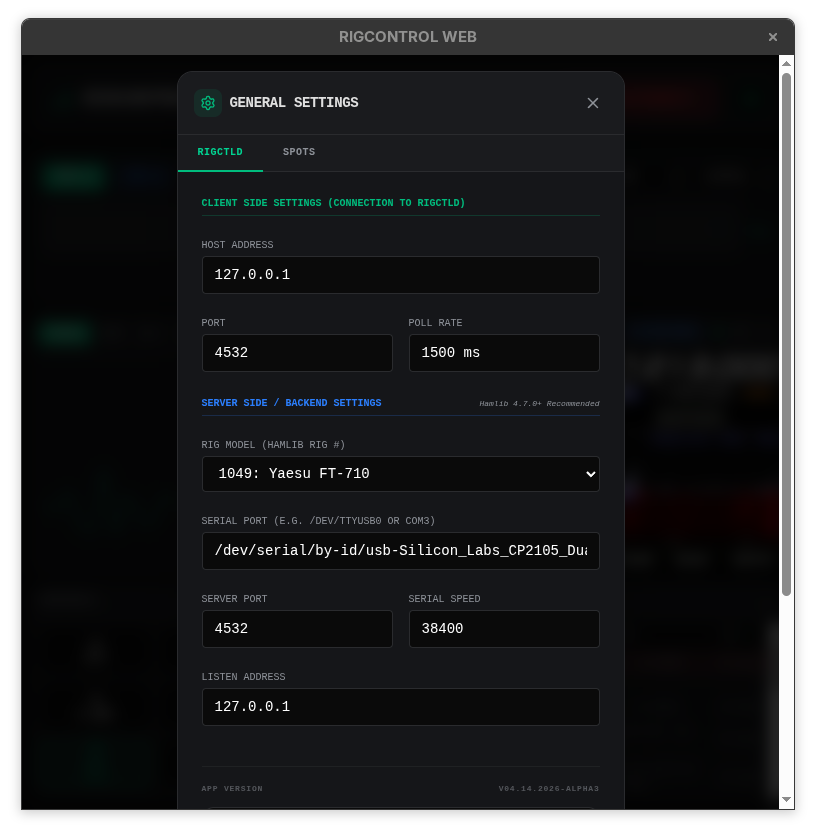

# Setting Up rigctld

Before RigControl Web can talk to your radio, it needs a program called `rigctld` running in the background. Think of `rigctld` as a translator — it speaks your radio's language over the USB or serial cable, and lets RigControl Web (and any other Hamlib-compatible logging software) talk to it over a simple network connection on your computer.

This page walks you through configuring and starting `rigctld` from inside the app.

---

## Opening General Settings

Click the **gear icon** (⚙) in the top-right corner of the app to open **General Settings**. The settings panel has two tabs: **RIGCTLD** and **CW**. Make sure you are on the **RIGCTLD** tab.



---

## Understanding the Two Sections

The RIGCTLD tab is divided into two sections with different background colors:

- **Client Side Settings** (green heading) — These control how the *app* connects to `rigctld`. In almost all cases you can leave these at their defaults.
- **Server Side / Backend Settings** (blue heading) — These control how `rigctld` connects to your *radio*. You will need to fill these in for your specific radio and computer.

---

## Client Side Settings

These settings tell the app where to find the running `rigctld` process.

| Field | What it does | Default |
|-------|-------------|---------|
| **Host Address** | The address where `rigctld` is running. Use `127.0.0.1` if it's on the same computer as the app. | `127.0.0.1` |
| **Port** | The network port `rigctld` listens on. | `4532` |
| **Poll Rate** | How often the app asks the radio for its current frequency, mode, and meter readings. Lower values feel more responsive but put more load on the radio's serial connection. 1000–1500 ms is a good starting point for most radios. | `1500 ms` |

> **Note for advanced users:** If you are running `rigctld` on a separate computer (for example, a headless server in your shack), enter that computer's IP address in the Host Address field here.

---

## Server Side / Backend Settings

These settings are passed directly to `rigctld` when the app starts it. You must configure these correctly for your radio.

| Field | What it does | Example |
|-------|-------------|---------|
| **Rig Model** | Your radio's Hamlib model number. Use the dropdown to search by manufacturer and model name. | `1049: Yaesu FT-710` |
| **Serial Port** | The serial or USB port your radio's CAT cable is connected to. Click the field to see serial devices detected on the machine running RigControl Web, or type a path manually. On Linux this looks like `/dev/ttyUSB0` or `/dev/serial/by-id/...`. On Windows it looks like `COM3`. | `/dev/ttyUSB0` |
| **Server Port** | The port `rigctld` will listen on. Should match the Port in Client Side Settings above. | `4532` |
| **Serial Speed** | The baud rate (communication speed) for your radio's CAT connection. Check your radio's manual for the correct value. Common values are `9600`, `19200`, and `38400`. | `38400` |
| **Listen Address** | The network address `rigctld` will accept connections from. Leave this at `127.0.0.1` for local use only. To accept connections from other computers on your network, change this to `0.0.0.0`. | `127.0.0.1` |

> **Serial Port is an autocomplete field, not a strict dropdown.** Clicking it queries the RigControl Web *server* (not your browser) for currently-attached serial devices and lists them as suggestions — on Linux it prefers the stable `/dev/serial/by-id/...` name over `/dev/ttyUSB0`, since the latter can shift if you have other USB devices connected. You can still type any path by hand; this matters if you're running the browser on a different computer than the server (see [Headless Deployment](Headless-Deployment)) or if your device isn't detected for some reason.

> **Linux: permission denied / error opening port?** Serial devices (`/dev/ttyUSB*`, `/dev/ttyACM*`) are owned by the `dialout` group on most distributions. If `rigctld` fails to open the port, add your user to that group:
>
> ```bash
> sudo usermod -aG dialout $USER
> ```
>
> Log out and back in (or reboot) for the new group membership to take effect. This same permission is also required for the CW keyer's DTR/RTS line if you use it.

> **Can't find your port in the list, or want to double-check on Windows?** Open Device Manager and look under "Ports (COM & LPT)" with your radio connected.

### PTT Type and CM108 GPIO PTT

The **PTT Type** buttons choose how the radio is keyed: **CI-V / CAT** (the radio's own command, the default), **DTR** or **RTS** (a handshake line on the radio's serial port, e.g. IC-7300), **CM108 GPIO**, or **None**.

**CM108 GPIO** is for simple radio interfaces with no CAT control, such as the AllScan.info and Masters Communications interfaces, which key the radio from a GPIO pin on a CM108/CM119 USB sound chip (GPIO3 on these boards). This is typically how a mobile VHF/UHF radio is connected. The same USB device carries the radio's audio, so Backend Audio works with it as usual.

1. Set **Rig Model** to the Hamlib **Dummy** rig (`1: Hamlib Dummy`). The radio has no CAT, so Hamlib has nothing to talk to; the serial port can stay empty. Frequency and meters will show simulated values, so you may want to remove the VFO and meter panels from your layout.
2. Set **PTT Type** to **CM108 GPIO**, leave **CM108 Device** on **Auto** (the only attached CM108-compatible device) and **GPIO** on `GPIO3` unless your interface says otherwise. GPIO2 and GPIO4 are also available; GPIO1 is not, because Hamlib treats it as "unset" and would key GPIO3 instead.
3. Start rigctld. The PTT button, hotkey, CW "CAT PTT" mode and the WSJT-X bridge all key the GPIO.

If several CM108 devices are attached, pick one from the **CM108 Device** list (Linux lists them with their `/dev/hidrawN` node) instead of Auto. With a real CAT radio the GPIO is used *instead of* CI-V for PTT.

| Platform | Notes |
|----------|-------|
| **Linux** | Needs read/write access to the `/dev/hidrawN` node, which is normally `root`-only. A udev rule such as `SUBSYSTEM=="hidraw", ATTRS{idVendor}=="0d8c", MODE="0660", GROUP="plugdev", TAG+="uaccess"` (then `sudo udevadm control --reload && sudo udevadm trigger`) grants access. In Docker, pass the device with `--device=/dev/hidrawN`. |
| **Windows** | Uses the Windows HID API; no driver or extra software needed. Leave the device on Auto unless several CM108 devices are attached. |
| **macOS** | Uses IOKit's HID API. Leave the device on Auto unless several are attached. You may see a macOS privacy prompt the first time. |

> **Windows and macOS need a rigctld built with CM108 support for those platforms** (the one bundled with RigControl Web is). A `rigctld` installed from your package manager or Hamlib's own installer may only support CM108 on Linux,.

---

## Starting rigctld

Once your settings are filled in, scroll down to the bottom of the RIGCTLD tab. You will see a status bar with **Test**, **Start**, and **Stop** buttons.

- **Test** — Checks whether `rigctld` can be found on your system and verifies your settings without actually starting it. Run this first if you are unsure. A "Test Passed" message means everything looks good.
- **Start** — Starts `rigctld` with your settings. The status indicator will turn green and show **RUNNING** when it is up.
- **Stop** — Stops the running `rigctld` process.

> **Auto-start:** RigControl Web remembers whether `rigctld` was running when you last closed the app. If it was running, it will start it automatically next time you launch. If you stopped it before closing, it will not auto-start.

---

## Process Logs

Below the Start/Stop controls is a **Process Logs** panel. This shows the last 100 lines of output from `rigctld`. If something is not working — for example, the app cannot connect to your radio — this is the first place to look. Common messages you might see:

- `rigctld: rig opened successfully` — Everything is working.
- `error opening port` — The Serial Port field is wrong, or the radio is not plugged in.
- `bind: Address already in use` — Something else (another copy of `rigctld`, a logging program) is already using port 4532. See the section below.

---

## Port Conflicts

If `rigctld` is already running on your computer from another program (WSJT-X, for example), the Start button will show an error and the status will display **ALREADY RUNNING**. You have two options:

1. **Stop the other program** and then click Start.
2. Click **Kill and Restart** — this forcibly stops any existing `rigctld` process and starts a fresh one with your current settings. Use this with caution if other programs are actively using `rigctld`.

---

## Using rigctld With Other Software

Because `rigctld` exposes a standard network interface, you can configure any Hamlib-compatible logging or digital mode program to connect to it alongside RigControl Web. In programs like WSJT-X, FLDigi, VarAC, or JS8Call, choose **Hamlib NET rigctl** as the rig type and set the network address to `127.0.0.1:4532`. All programs will share the same radio connection without needing separate serial port splitters.

---

## Spectrum Scope

RigControl Web can display a live panadapter and waterfall from your radio in the **Spectrum Scope** panel. Two independent source modes are supported — select the one that matches your radio.

Add the **Spectrum Scope** panel to your layout via **Add Panel**, then click its gear icon to open the Spectrum Scope settings modal, where you choose the source and enable the scope.

---

### Hamlib UDP (Icom IC-7300, IC-7300MK2, IC-7610, IC-7850/7851, IC-705, IC-9700, IC-905)

These Icom radios can stream live spectrum data over their CI-V bus while `rigctld` is connected. RigControl Web receives the data via Hamlib's UDP multicast stream.

#### Requirements

- **Serial speed set to 115200 baud.** The IC-7300 and similar radios only stream spectrum data at this baud rate.
- **CI-V Transceive OFF** in the radio's CI-V menu. The app uses polling; transceive mode sends unsolicited data that can interfere.
- **CI-V USB Echo ON** in the radio's CI-V menu. This allows Hamlib to verify CI-V commands are received by the radio.

#### Enabling

See the [Hamlib UDP Spectrum Scope Setup](Spectrum-Scope-Hamlib-UDP) page for complete radio menu settings and step-by-step instructions.

In brief: in the Spectrum Scope settings modal, set **Source** to **Hamlib UDP**, then enable the scope. Click **Stop** and **Start** (or **Kill and Restart**) in the RIGCTLD settings to restart `rigctld` with multicast enabled.

> If the spectrum scope toggle is enabled but your `rigctld` binary does not support multicast, `rigctld` will exit immediately with an error. RigControl Web detects this and **automatically disables the toggle** so rig control resumes on the next start. Check the Process Logs panel for the error message.

#### Multicast Address and Port

The default multicast address (`224.0.0.1`) and port (`4531`) match Hamlib's defaults and work for single-machine setups. Advanced users running `rigctld` on a separate machine from the app can change these to route spectrum data across a network.

---

### FT-710 via USB (Yaesu FT-710)

The Yaesu FT-710's single USB cable exposes three devices to your computer: the CP2105 CAT serial port, USB audio, and a dedicated **FTDI FT4222H chip** that streams the live waterfall. This path does not use Hamlib and works independently of `rigctld`.

> **FT-710 only.** The FTDX101MP, FTDX101D, and FTDX10 are marketed as SCU-LAN10 compatible but route their spectrum data through the physical SCU-LAN10 Ethernet accessory using Yaesu's proprietary protocol. They do not expose an FT4222H USB device to the host PC and are not supported by this feature.

#### Requirements

- **`libft4222`** from FTDI must be installed on your computer. See the [FT-710 Spectrum Scope Setup](Spectrum-Scope-FT-710) page for full platform-specific setup instructions (Linux, macOS, Windows).
- The spectrum output must be enabled in the radio's menu: **OPERATION SETTING → GENERAL → SCU-LAN10: ON**. (This enables the FT-710's built-in FT4222H chip over USB — no physical SCU-LAN10 device is needed.)

#### Enabling

In the Spectrum Scope settings modal, set **Source** to **FT-710 USB (FT4222)** and enable the scope. The app spawns the `ft4222-scope-reader` helper binary, which connects to the FT4222H device and streams frame data. A status indicator in the panel shows whether the reader is running or has encountered an error.

#### Span Control

The settings modal includes a **span selector** with 10 presets from 1 kHz to 1 MHz. Clicking a preset sends a CAT command directly to the radio via `rigctld` and saves the preference. A live readout next to the buttons shows the span currently being reported by the radio's frame data.
